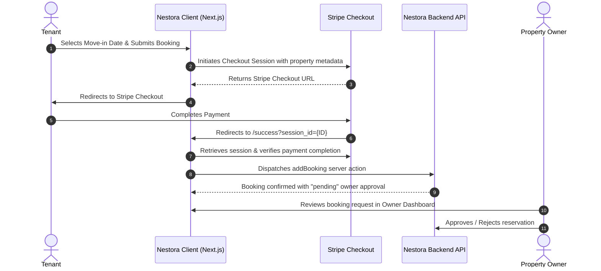

# 🏠 Nestora - Property Rental & Booking Platform

[](https://nextjs.org/)
[](https://react.dev/)
[](https://tailwindcss.com/)
[](https://better-auth.com/)
[](https://www.mongodb.com/)
[](https://stripe.com/)

**Nestora** is a modern, high-performance, full-stack property rental and booking web platform built with the **Next.js App Router**, **React 19**, and **Tailwind CSS v4**. It bridges the gap between property owners, prospective tenants, and administrators by providing seamless property discovery, automated reservation workflows, secure Stripe checkout, and role-tailored dashboards.

---

## 🌟 Key Highlights & Feature Matrix

### 👤 Tenant & Public Experience
- **Smart Property Discovery:** Interactive search banner with dynamic filters by keyword, location, property type (Apartment, House, Condo, Studio, Villa), and price range.
- **Listing Gallery & Pagination:** Grid view of verified properties with responsive pagination and persistent search queries.
- **Detailed Property Showcase:**
  - High-resolution image view with dynamic status tags.
  - Specification highlights (Bedrooms, Bathrooms, Sqft size, Property Type).
  - Categorized amenities checklist (WiFi, AC, Parking, Elevator, Generator, Gym, Pool, Security, etc.).
  - Verified property owner info and direct contact details.
- **Interactive Review System:** Read feedback and post reviews/comments on properties.
- **Wishlist / Favorites:** Bookmark desired properties for quick access and manage saved listings.
- **Seamless Stripe Booking:** Direct booking modal with move-in date selection, emergency contact info, and Stripe Checkout redirection.
- **Tenant Dashboard:**
  - **My Bookings:** Real-time reservation status tracker (`pending`, `paid`, `approved`) with transaction references.
  - **Favorites:** Saved listings manager with instant removal and navigation.
  - **Profile Management:** Manage personal credentials and account details.

---

### 🔑 Property Owner Portal
- **Owner Analytics & Insights:**
  - Metric summary cards: Total earnings (৳ / BDT), total properties listed, and confirmed bookings.
  - Interactive **Recharts Area Chart** showcasing monthly earnings progression over time.
- **Property Listing Management:**
  - Add listings with integrated **ImgBB** cloud image hosting.
  - Granular property attributes: rent type (Daily, Weekly, Monthly), room specs, and amenities checklist.
  - Real-time approval status tracking (`pending`, `approved`, `rejected` with administrator feedback).
  - Edit and delete properties directly from the dashboard.
- **Booking Requests Workflow:** Review incoming tenant reservation requests with one-click approval or rejection.
- **Owner Profile:** Update contact details and profile preferences.

---

### 🛡️ Administrator Control Center
- **System-Wide Analytics:**
  - Platform overview: Total Gross Volume, active properties count, total reservations, total tenants, and registered owners.
  - Interactive revenue visualization chart across 12 months.
- **User Role Management:** View all platform users and modify roles (`tenant`, `owner`, `admin`) via server actions.
- **Listing Moderation:**
  - Review submitted listings before they appear in public search.
  - One-click approve or reject with custom feedback provided to the owner.
  - Edit or remove any listing directly to maintain catalog quality.
- **Transaction Records:** Complete financial audit trail of all Stripe payments including Payment Intent IDs, customer names, owners, amounts, and statuses.
- **All Bookings:** Platform-wide oversight of all booking activities.

---

### 🎨 UI/UX & Design Philosophy
- **Dark & Light Mode:** Seamless theme switching powered by `next-themes` and Tailwind CSS.
- **Modern Component Ecosystem:** Styled with **Tailwind CSS v4**, **DaisyUI v5**, and **HeroUI**.
- **Smooth Animations:** Interactive transitions and micro-interactions using **Framer Motion**.
- **Toast Notifications:** Feedback on actions powered by `react-toastify`.

---

## 🛠️ Tech Stack & Architecture

| Layer | Technologies |
| :--- | :--- |
| **Framework** | [Next.js 16](https://nextjs.org/) (App Router, Server Actions, Server Components, API Routes) |
| **Frontend Library** | [React 19](https://react.dev/) |
| **Styling & Design** | [Tailwind CSS v4](https://tailwindcss.com/), [DaisyUI v5](https://daisyui.com/), [HeroUI](https://heroui.com/) |
| **Icons & Animation** | [Lucide React](https://lucide.dev/), [React Icons](https://react-icons.github.io/react-icons/), [Framer Motion](https://www.framer.com/motion/) |
| **Authentication** | [Better Auth](https://better-auth.com/) (MongoDB Adapter, Email/Password, Google OAuth, JWT cookies) |
| **Database** | [MongoDB](https://www.mongodb.com/) (Native Driver 7.6) |
| **Payment Gateway** | [Stripe](https://stripe.com/) (`stripe` SDK & `@stripe/stripe-js` Checkout) |
| **Charts & Analytics** | [Recharts](https://recharts.org/) |
| **Image Uploads** | [ImgBB REST API](https://api.imgbb.com/) |

---

## 📂 Project Directory Structure

```text
property-rental-and-booking-platform-client/
├── public/                     # Static assets & icons
├── src/
│   └── app/
│       ├── api/
│       │   ├── auth/[...all]/  # Better Auth API handler route
│       │   └── payment/        # Stripe Checkout session creator route
│       ├── components/         # Reusable presentation & client components
│       │   ├── dashboard/      # Role-specific dashboard layouts & cards
│       │   │   ├── admin/      # Admin overview chart, property editor
│       │   │   └── owner/      # Owner dashboard home, property actions
│       │   ├── Banner.jsx      # Hero banner with multi-filter search
│       │   ├── Booking.jsx     # Booking modal & Stripe redirection
│       │   ├── Navbar.jsx      # Navigation bar with responsive drawer
│       │   ├── PropertyCard.jsx# Property listing card
│       │   ├── PropertyFilterBar.jsx # Dynamic filter bar
│       │   └── ThemeToggle.jsx # Light/dark mode switcher
│       ├── dashboard/          # Protected role-based dashboard routes
│       │   ├── admin/          # Users, properties, transactions, bookings
│       │   ├── owner/          # Add property, my properties, booking requests
│       │   ├── tenant/         # Bookings, favorites, profile
│       │   ├── layout.js       # Dashboard sidebar wrapper
│       │   └── page.jsx        # Dashboard entry router based on user role
│       ├── lib/                # Utility functions, server actions, configs
│       │   ├── action.js       # Next.js Server Actions (mutations)
│       │   ├── auth.js         # Better Auth server configuration
│       │   ├── auth-client.js  # Better Auth client hook initialization
│       │   ├── data.js         # Centralized API fetch helpers
│       │   ├── stripe.js       # Stripe server-only SDK instance
│       │   └── image/          # ImgBB upload service
│       ├── login/              # Sign-in page (Email + Google OAuth)
│       ├── properties/         # Property listings & [id] details page
│       ├── register/           # Registration page with avatar upload
│       ├── success/            # Stripe payment success callback handler
│       ├── layout.js           # Root layout with providers & toast setup
│       ├── page.js             # Landing page
│       └── globals.css         # Global Tailwind styles
├── .env.example                # Sample environment variables
├── next.config.mjs             # Next.js configuration (Remote image patterns)
├── package.json                # Project dependencies and npm scripts
└── README.md                   # Project documentation
```

---

## ⚙️ Environment Variables

Create a `.env` file in the root directory and configure the following variables (refer to `.env.example`):

| Variable Name | Description | Example / Format |
| :--- | :--- | :--- |
| `BETTER_AUTH_SECRET` | Secret key used for signing session tokens | `random_32_char_secret_string` |
| `BETTER_AUTH_URL` | Canonical URL of the client application | `http://localhost:3000` |
| `MONGO_URI` | MongoDB connection string | `mongodb+srv://<user>:<pwd>@cluster.mongodb.net/property-assignment` |
| `GOOGLE_CLIENT_ID` | Google OAuth Client ID | `xxxx.apps.googleusercontent.com` |
| `GOOGLE_CLIENT_SECRET` | Google OAuth Client Secret | `GOCSPX-xxxx` |
| `NEXT_PUBLIC_SERVER_URL` | Backend REST API server URL | `http://localhost:5000` |
| `NEXT_PUBLIC_IMG_API` | ImgBB API key for uploading photos | `your_imgbb_api_key` |
| `NEXT_PUBLIC_STRIPE_PUBLISHABLE_KEY` | Stripe Publishable Key | `pk_test_...` |
| `STRIPE_SECRET_KEY` | Stripe Secret Key | `sk_test_...` |

---

## 🚀 Getting Started

### 1. Prerequisites
Ensure you have the following installed on your machine:
- **Node.js** (v18.18 or later recommended)
- **npm**, **yarn**, or **pnpm**
- A running **MongoDB** database instance or Atlas cluster
- A running instance of the **Nestora Backend API**

### 2. Clone the Repository
```bash
git clone https://github.com/shuvro18/property-rental-and-booking-platform-client.git
cd property-rental-and-booking-platform-client
```

### 3. Install Dependencies
```bash
npm install
```

### 4. Configure Environment Variables
Copy the template file to `.env`:
```bash
cp .env.example .env
```
Fill in all required values in `.env` as described in the [Environment Variables](#️-environment-variables) section.

### 5. Run the Development Server
```bash
npm run dev
```

Open [http://localhost:3000](http://localhost:3000) in your browser to view the application.

---

## 📜 Available NPM Scripts

- `npm run dev`: Starts the Next.js development server with Turbopack / Fast Refresh.
- `npm run build`: Compiles the application for production deployment.
- `npm run start`: Launches the compiled Next.js production server.
- `npm run lint`: Runs ESLint to check for code quality and syntax errors.

---

## 🔒 Authentication & Role-Based Access Flow

1. **User Sign Up:** Users register with Name, Email, Password, and Profile Image. Default role assigned is `tenant`.
2. **Social Login:** Fast one-click authentication through Google OAuth.
3. **Session Management:** Handled via Better Auth with JWT cookie cache and MongoDB user records.
4. **Role-Based Routing:**
   - **Tenant:** Access to `/dashboard/tenant/*` (Bookings, Favorites, Profile).
   - **Owner:** Access to `/dashboard/owner/*` (Analytics overview, Add Listing, Listing Management, Booking Requests).
   - **Admin:** Access to `/dashboard/admin/*` (All Users, Role Management, Property Verification, Global Bookings, Financial Transactions).

---

## 💳 Payment & Booking Lifecycle



---

## 🤝 Contributing

Contributions, issues, and feature requests are welcome!
Feel free to open an issue or submit a pull request on the repository.

1. Fork the Project
2. Create your Feature Branch (`git checkout -b feature/AmazingFeature`)
3. Commit your Changes (`git commit -m 'Add some AmazingFeature'`)
4. Push to the Branch (`git push origin feature/AmazingFeature`)
5. Open a Pull Request

---

## 📄 License

This project is licensed under the [MIT License](LICENSE).
